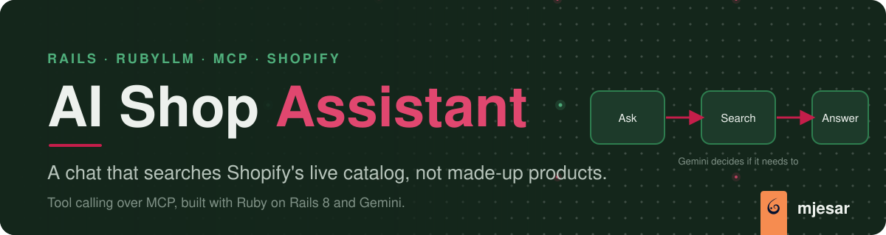
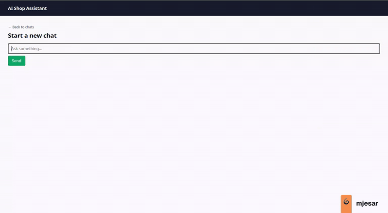
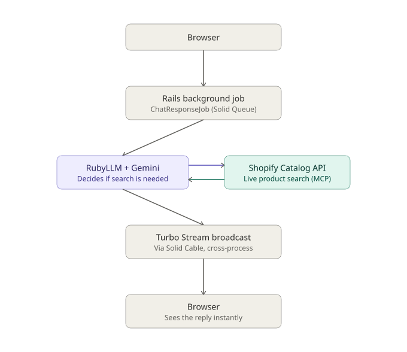
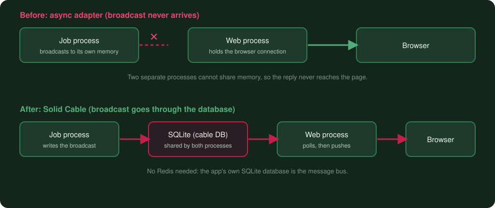

<h1 align="center">
  
</h1>

<p align="center"><strong>A shopping chat where the AI searches Shopify's real catalog instead of making products up.</strong></p>

<p align="center">
  <a href="https://github.com/mjesar/ai_shop_assistant/actions/workflows/ci.yml"></a>
  
  
  
  
  
  <a href="LICENSE"></a>
</p>

**AI Shop Assistant is a Ruby on Rails 8 chat app where an AI model searches Shopify's live product catalog before it answers.** Ask for "a snowboard under $500" and you get real products, real prices and working links.

It is a small, working example of LLM tool calling: the model decides when it needs a search, and the app runs it. The shopping features in ChatGPT, Perplexity and Copilot use the same pattern. This one is built from scratch in Ruby.

<p align="center">
  
</p>

<details>
<summary>Text version of the demo</summary>

A real chat in the browser, recorded on 2026-10-24:

1. **"Hi, what can you help me with?"** The assistant says it can search the product catalog. It also says it cannot check orders, shipping, returns or store policies. No search runs.
2. **"Find me a snowboard under $500"** A yellow "Searching Shopify's catalog..." line appears while the search runs. Then the reply lists the Salomon Pulse Snowboard Mens 2026 at $279.95, with a link to the store.
3. **"Can you check my order #1042?"** The assistant says it cannot check orders and offers to search for products instead.

Each reply appears without a page reload. The background job sends it to the browser as a Turbo Stream.

</details>

## Why this exists

An AI model with no way to look things up will invent a product, a price or a link. In a shopping chat, a made-up price is worse than no answer.

The fix is tool calling. I give the model one tool, `SearchProducts`. When a question needs product data, the model asks for a search. The app runs it against Shopify's catalog, and the model answers from the results.

### Real runs

These questions went to `gemini-3.5-flash-lite` with the `SearchProducts` tool, against the live catalog on 2026-10-24. The catalog changes, so the same question can return different products on another day.

| Question | Tool calls | What the catalog returned | What the model answered |
|---|---|---|---|
| "Find me a snowboard under $500" | 1 (`snowboard`) | 3 snowboards: $279.95, $649.95, $549.95 | Only the Salomon Pulse at $279.95, dropping the two over budget |
| "red running shoes" | 1 (`red running shoes`) | 3 pairs: $187.00, $79.98, $127.00 | All 3, with names, prices and links |
| "Hi, what can you help me with?" (no system prompt) | 0 | (no search) | Offered to check order statuses and store policies, which it cannot do |
| "Hi, what can you help me with?" (with the system prompt) | 0 | (no search) | "I can help you find products from our store!" and offered to search the catalog |
| "Can you check my order #1042?" (with the system prompt) | 0 | (no search) | "I'm sorry, I cannot check orders, shipping, returns, accounts, or store policies." |

The first two rows show the idea working. The model searched, then reasoned over the real results: it dropped the two snowboards over budget on its own.

The third row was a real failure. With no system prompt, the model invented a store assistant with abilities it does not have. A short system prompt fixed it, as the last two rows show.

## Quick start

You need Ruby 4.0.4 (see `.ruby-version`) and MongoDB running locally.

**Run the tests.** They need no API keys, because they stub every call to Gemini and Shopify.

```bash
git clone https://github.com/mjesar/ai_shop_assistant.git
cd ai_shop_assistant
bundle install
bundle exec rspec
```

This is the real output on my machine:

```
...............

Finished in 1.07 seconds (files took 2.38 seconds to load)
15 examples, 0 failures
```

**Run the app.** You need a Gemini API key and Shopify Catalog client credentials.

```bash
cp .env.example .env     # fill in GEMINI_API_KEY, SHOPIFY_CATALOG_CLIENT_ID, SHOPIFY_CATALOG_CLIENT_SECRET
bin/rails db:prepare     # creates the Solid Queue and Solid Cable SQLite databases
bin/dev                  # web server, Tailwind watcher and job worker together
```

Then open http://localhost:3000/chats. Background jobs are visible at http://localhost:3000/jobs. MongoDB connection settings are in `config/mongoid.yml`.

## How it works

A normal model call is `Question → Answer`. With tool calling it becomes `Question → (maybe) Search → Answer`, and the model chooses whether to search.

<p align="center">
  
</p>

<details>
<summary>Text version of the diagram</summary>

1. **Browser**: the user types a message and submits it.
2. **Rails background job** (`ChatResponseJob`, run by Solid Queue): the controller saves the message and hands the slow model call to this job, so the web request returns at once.
3. **RubyLLM + Gemini**: the job asks Gemini to answer and decides, through the model, whether a product search is needed.
4. **Shopify Catalog API** (live product search over MCP): if a search is needed, the `SearchProducts` tool gets a token, calls the catalog and returns up to three products.
5. **Turbo Stream broadcast** (through Solid Cable, across processes): the saved reply is broadcast to the browser, which shows it instantly.

</details>

Step by step, with the file that does each part:

1. **Save and queue.** [`ChatsController#create`](app/controllers/chats_controller.rb) calls `Chat.start!`, which saves the first message and queues a job. Later messages go through [`MessagesController#create`](app/controllers/messages_controller.rb), which returns at once.
2. **Run the model in a background job.** [`ChatResponseJob`](app/jobs/chat_response_job.rb) calls `Chat#generate_response`, so a slow Gemini reply never blocks a web request. If the chat was deleted in the meantime, the job logs it and stops.
3. **Set up the model.** [`Chat#generate_response`](app/models/chat.rb) builds the chat with one instruction set and one tool:
   ```ruby
   RubyLLM.chat(model: model_id).with_instructions(INSTRUCTIONS).with_tools(SearchProducts)
   ```
   The instructions say product search is its only ability. Then it replays the earlier messages, so the model remembers the conversation.
4. **Let the model decide.** If the question needs product data, the model asks for the tool. The `before_tool_call` hook then shows a "searching" line in the browser ([`messages/_tool_status`](app/views/messages/_tool_status.html.erb)). Otherwise no search runs.
5. **Search the live catalog.** [`SearchProducts`](app/tools/search_products.rb) gets an OAuth 2.0 token from `https://api.shopify.com/auth/access_token` ([`config/initializers/ruby_llm.rb`](config/initializers/ruby_llm.rb)). It then sends a JSON-RPC `tools/call` for `search_catalog` to `https://catalog.shopify.com/api/ucp/mcp`. It keeps the first three products, each reduced to a title, a price and a URL. Prices arrive in minor units (`27995` means $279.95), and the model converts them.
6. **Save and stream the reply.** The assistant message is saved, and [`Message`](app/models/message.rb) broadcasts itself to the browser as a Turbo Stream. If anything fails, the "searching" line is removed and the user sees a friendly error. The error is then raised again, so it shows up in the jobs dashboard at `/jobs` (Mission Control: Jobs).

## What went wrong, and how it was fixed

**1. Replies never reached the browser.** The chat saved messages, but the live reply from the background job never appeared. Action Cable's default `async` adapter keeps broadcasts in one process's memory. The job runs in a different process from the web server, so the browser never heard it. I switched to Solid Cable, which passes broadcasts through a shared SQLite database ([`config/cable.yml`](config/cable.yml)).

<p align="center">
  
</p>

<details>
<summary>Text version of the diagram</summary>

**Before (async adapter):** the job process broadcasts into its own memory. The web process, which holds the browser's WebSocket connection, is a different process and never hears it, so the reply never appears.

**After (Solid Cable):** the job process writes the broadcast to a SQLite database that both processes share. The web process polls that database (every 0.1 seconds in [`config/cable.yml`](config/cable.yml)) and pushes the message to the browser. No Redis is needed.

</details>

**2. The assistant forgot the conversation.** Each background job builds a new `RubyLLM::Chat`, so on the second message the model had no memory of the first. Now `Chat#generate_response` replays the saved messages into the new chat before asking. A spec covers it: it says "My name is Alex", asks "What is my name?" and checks that the earlier turns are replayed.

**3. The assistant claimed abilities it did not have.** Asked "what can you help me with?", the model offered to check orders and store policies. Its only tool is product search, but nothing told it that was all it could do. A short system prompt (`Chat::INSTRUCTIONS`) now names its one ability and what it cannot do. A spec checks that the prompt is sent, and the [real runs](#real-runs) show the before and after.

**About the tests.** All 15 specs stub RubyLLM and HTTP, so the suite is fast and never spends API quota. The trade-off: they do not prove the live Gemini and Shopify calls work. I check those by running the app, as in the demo and the real runs above.

## Key terms

- **Tool calling (function calling):** a model cannot query anything on its own. You describe a function to it, it replies "please run this with these arguments", your code runs it, and the result goes back to the model.
- **MCP (Model Context Protocol):** an open protocol that lets an AI app call tools on a remote server. Here it is JSON-RPC over HTTP, using one method, `tools/call`.
- **Shopify Catalog API:** Shopify's API for searching products across many merchants. This app uses its UCP endpoint at `catalog.shopify.com/api/ucp/mcp`.
- **RubyLLM:** a Ruby gem with one interface for many model providers (OpenAI, Anthropic, Gemini and others), including chat and tool calling.
- **Turbo Streams:** Hotwire's way of sending small HTML updates over a WebSocket, so a page changes without a reload.
- **Solid Queue:** the Rails 8 background job system, backed by a database. It runs `ChatResponseJob`.
- **Solid Cable:** the Rails 8 Action Cable adapter, backed by a database. It carries broadcasts between processes without Redis.
- **Mongoid:** the MongoDB object mapper for Ruby, used here instead of ActiveRecord for chats and messages.

## Project structure

```
ai_shop_assistant/
├── app/
│   ├── tools/
│   │   └── search_products.rb      <-- the one tool the model can call (Shopify catalog search over MCP)
│   ├── models/
│   │   ├── chat.rb                 <-- builds the RubyLLM chat, replays history, broadcasts tool status and errors
│   │   └── message.rb              <-- a saved message; broadcasts itself with Turbo Streams
│   ├── jobs/
│   │   └── chat_response_job.rb    <-- runs the model call outside the web request
│   ├── controllers/                <-- chats_controller.rb and messages_controller.rb
│   ├── helpers/
│   │   └── messages_helper.rb      <-- render_markdown for assistant replies
│   └── views/{chats,messages}/     <-- chat UI, message, tool status and error partials
├── config/
│   ├── initializers/ruby_llm.rb    <-- Gemini key and the Shopify OAuth token fetch
│   ├── cable.yml, queue.yml        <-- Solid Cable and Solid Queue setup
│   └── mongoid.yml                 <-- MongoDB connection
├── spec/                           <-- RSpec: models, tool, job, request specs, helper
├── assets/readme/                  <-- images used by this README
└── .env.example                    <-- the three keys you need
```

| Spec file | What it covers |
|---|---|
| `spec/models/chat_spec.rb` | Saving the user message, the system prompt, replaying history into a fresh LLM chat, `Chat.start!` |
| `spec/models/message_spec.rb` | Message validations |
| `spec/tools/search_products_spec.rb` | The tool returns products from a stubbed catalog response |
| `spec/jobs/chat_response_job_spec.rb` | The job calls `generate_response` |
| `spec/requests/` | Chats and messages endpoints |
| `spec/helpers/messages_helper_spec.rb` | Markdown rendering |

You can ignore `bin/`, `config.ru`, `Dockerfile`, `.kamal/`, `public/`, `storage/`, `tmp/` and `log/`: they are standard Rails 8 boilerplate. `app/mailers/` and `app/views/pwa/` are generated and unused.

## FAQ

#### How do I add tool calling to a Rails app with RubyLLM?
Subclass `RubyLLM::Tool`, describe it and its parameters, and implement `execute`. Attach it with `RubyLLM.chat(...).with_tools(YourTool)`. The model then decides when to call it. [`SearchProducts`](app/tools/search_products.rb) is a working example.

#### How do I call an MCP server from Ruby?
An MCP call over HTTP is a JSON-RPC POST. This app sends `tools/call` with the tool name `search_catalog` and an `Authorization: Bearer` header, using plain `Net::HTTP`. I started with the `ruby_llm-mcp` gem, but it crashed on this server's handshake, so I filed [ruby_llm-mcp#155](https://github.com/patvice/ruby_llm-mcp/issues/155) and dropped it.

#### Why do live updates from a background job need Solid Cable or Redis?
The job and the web server are separate processes, and the default `async` adapter only broadcasts inside one process. See [fix 1](#what-went-wrong-and-how-it-was-fixed).

#### Does this use ActiveRecord?
No. Chats and messages are Mongoid documents in MongoDB. RubyLLM's `acts_as_chat` only works with ActiveRecord, so `Chat` and `Message` persistence is written by hand.

## Learn more

- [RubyLLM documentation](https://rubyllm.com): tools, chat and providers.
- [Model Context Protocol](https://modelcontextprotocol.io): the protocol behind the catalog call.
- [Shopify Catalog API documentation](https://shopify.dev): Shopify's developer docs.
- [Solid Cable](https://github.com/rails/solid_cable) and [Solid Queue](https://github.com/rails/solid_queue): the Rails 8 database-backed adapters.
- [ruby_llm-mcp#155](https://github.com/patvice/ruby_llm-mcp/issues/155): the upstream bug I filed.

## Tech stack

- Ruby 4.0.4 and Rails 8.1
- RubyLLM 2.1 with the Gemini API (`gemini-3.5-flash-lite`)
- Shopify Catalog API over MCP (JSON-RPC), OAuth 2.0 client credentials
- Hotwire (Turbo 2, Stimulus), Action Cable with Solid Cable 4.1
- Solid Queue 1.7 and Mission Control: Jobs for background work
- MongoDB with Mongoid 9.1 (chats and messages), SQLite (queue and cable)
- Tailwind CSS and Redcarpet (Markdown in replies)
- RSpec, FactoryBot, Shoulda Matchers and Capybara for tests

## Status

It works end to end: you can chat, the model searches the live catalog, and replies stream in. It is a learning and portfolio project, not a production store assistant.

- It returns at most three products per search.
- It only searches. There is no cart, checkout or account.
- The specs stub every external call, so no automated test checks the live APIs.

The code is released under the [MIT License](LICENSE).

## Related work

- [`shop_mcp_server`](https://github.com/mjesar/shop_mcp_server): the other side of MCP, a Rails server that exposes a store to LLMs, with RAG over pgvector.
- [`product_geo_agent`](https://github.com/mjesar/product_geo_agent): a Rails agent that scores how discoverable a Shopify product is to AI assistants.
- [`support_engineer`](https://github.com/mjesar/support_engineer): a Rails 8 AI support agent that investigates orders and shipments, searches company policies and asks a human before it acts. A learning project in progress.
